# Touchline

Touchline is a football research platform that connects match outcomes, on-ball
events, available spatial context, player roles, and competition simulations across
the five major European leagues and the UEFA Champions League.

The focus is football's continuous spatial action: possession value, the worth of
an action given where and when it happens, role-dependent contribution, and how a
season's structure turns team strength into a table forecast. This is deliberately
not a general statistics dump. Every measure is defined, every model owns its
target, and the knowledge available at prediction time is respected so later facts
cannot leak into earlier forecasts.

## What is here

- A typed football domain core: matches, periods, possessions, events, shots,
  appearances, team and player identities, venues, score state, and competition
  rules, with clocks that keep halves, extra time, stoppage time, and shootouts
  distinct.
- Parsers for real open datasets: the StatsBomb / Hudl open-data event schema and
  the football-data.co.uk historical results files. Acquisition is budgeted,
  checksummed, and resumable; verified against live StatsBomb open data.
- Original models with documented targets: Elo and Dixon-Coles score models, xG
  (logistic, gradient-boosted comparison, and a neural spatial model), a grid-based
  expected-threat solve, a possession action-value model, a masked spatial player
  encoder, a causal possession-sequence encoder, and hierarchical shrinkage.
- A competition simulator with era-specific points, tie-breaks, and UCL formats
  (group stage, the 2024-25 league phase, away goals only through 2020-21).
- A chronological, leakage-aware feature pipeline with a split-integrity audit.
- A model registry, bounded CPU serving, and an independent verifier with semantic
  negative controls.

## Quick start

```bash
make bootstrap      # create the environment and install the package
make doctor         # report host capabilities and data availability
make demo           # run the end-to-end vertical slice on bundled sample data
make test           # run the correctness suite
```

The demo runs without any download using a small bundled synthetic sample (clearly
labelled, never counted as real data), so a fresh reader can see an event turn into
an xG value and a set of team strengths turn into a simulated table.

### Demo output

```
Touchline demo (synthetic sample data)
================================================
1) Expected goals
   trained log loss 0.4798 vs base-rate 0.6863 (lower is better)
   trained Brier    0.1563
   example shot (8 m, open angle) xG = 0.808
2) Team strength
   Dixon-Coles home advantage (log) +0.175, rho +0.077
   strongest attack: Club H (attack +0.706)
3) Simulated season (5000 draws), title probabilities
   Club H     P(1st) = 0.912 +/- 0.004
   Club B     P(1st) = 0.060 +/- 0.003
   Club C     P(1st) = 0.015 +/- 0.002
   Club H vs Club E: home 0.93 / draw 0.05 / away 0.02
```

The trained xG beats the base-rate predictor on held-out log loss, and the
strongest fitted team is the simulated title favourite, both from real models on the
sample.

## How it fits together



More diagrams (chronology/leakage, possession state, masked spatial encoding,
action-value targets, expected-threat solve, hierarchical strength, season-rule
execution, evidence lineage, failure/recovery, and the shot-to-xG path) are under
`docs/diagrams/`.

## A finding, stated honestly

Running the diagnostic campaign (`experiments.campaign`) across three seeds, the
neural xG trains cleanly (loss falls from about 0.69 to 0.45 every seed) but does
not beat the logistic baseline on held-out log loss (0.480 vs 0.496-0.512). On these
features the relationship is close to linear, so the extra capacity does not help.
This is a null result at diagnostic scale, recorded in
`docs/research/NEGATIVE_RESULTS.md`. Correlated strength draws lower the favourite's
title probability from 0.924 to 0.881, showing a point estimate understates forecast
uncertainty.

## Status

`docs/BUILD_STATUS.md` tracks which capabilities and acceptance gates are
implemented and runnable, and which are blocked on large data or compute that a
single build session cannot complete (the full 20k-match ingest, the 500k-event
slice, the 240-run campaign, 100k-draw showcases, and the remote full acceptance).
Nothing here is presented as more complete than it is, and no gate is marked passed
on fabricated data.

## Documentation

- `docs/ARCHITECTURE.md`, `docs/SPECIFICATION.md`, `docs/EXPERIMENT_PLAN.md`
- `docs/STATISTICAL_DICTIONARY.md` (+ machine-readable JSON)
- `docs/research/` (hypotheses, methods, run index, negative results, conclusions,
  thesis, thirteen focused writeups)
- `docs/adr/` (thirteen architecture decision records)
- `docs/DATASETS.md`, `docs/RECOVERY_RUNBOOK.md`, `docs/BENCHMARK_METHODOLOGY.md`

## Layout

```
src/touchline/      domain, ingest, parse, features, models, simulate,
                    registry, serving, coverage, quality, acceptance, verify
tests/              correctness, property, and differential tests
docs/               architecture, specification, research, diagrams, ADRs
```

## License and attribution

MIT. Dataset licenses are the data provider's; see `docs/DATASETS.md`. The
action-value formulation draws on Decroos et al., "Actions Speak Louder than Goals"
(KDD 2019) as a reference for valuing actions by their effect on scoring and
conceding probability.
