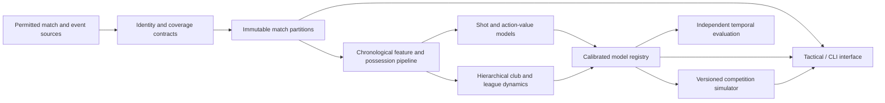

# Architecture

Touchline is built in layers that depend only downward. A lower layer never
imports a higher one, so the dependency graph is acyclic and each layer can be
tested in isolation.

```
domain      typed football objects, units, identifiers, clocks
ingest      budgeted acquisition, checksums, change detection, identity
parse       provider-specific readers that emit domain objects
features    chronological, leakage-aware feature construction and splits
models      Elo, Dixon-Coles, xG, expected threat, action value, encoders
simulate    competition rules and Monte Carlo season/tournament draws
registry    model cards, artifact store, resumable recovery
serving     batched CPU inference and batch simulation
coverage    competition-season-field coverage accounting
quality     reconciliation and data-quality investigations
acceptance  evidence-bundle production
verify      independent replay and semantic negative controls
pipeline    end-to-end wiring (the demo)
cli         command interface
```

## System context



## Why these boundaries

The split between `parse` and `domain` keeps provider quirks out of the modelling
code. A StatsBomb event and a football-data.co.uk row become the same canonical
objects, so a model never branches on provider. The `features` layer is the only
place that knows about knowledge time, which concentrates leakage control in one
testable module. The `verify` layer is intentionally separate from `acceptance`
so the thing that checks results shares no code path with the thing that produced
them.

## Key invariants

- Match time keeps period, stoppage, and shootout distinct (`domain.clock`).
- Canonical pitch coordinates grow toward the attacking goal (`domain.geometry`).
- Identifiers are provider-scoped; cross-provider links need evidence
  (`ingest.identity`).
- A feature may inform a prediction only if it was knowable at the origin
  (`features.registry`).
- Spatial models are never offered for event-only matches (`registry.model_card`).
- Simulations place each team at exactly one rank per draw (`simulate`).

## Data flow for one prediction

A shot's journey from raw bytes to an xG value:

1. `parse.statsbomb` reads the event JSON and builds a `domain.events.Shot` with a
   canonical location and the correct period/clock.
2. `features.shots` turns the shot into a feature row (distance, angle, body part,
   situation), offering spatial features only when a freeze frame exists.
3. `models.xg_logistic` (or `models.neural.spatial_xg`) maps the row to a goal
   probability using training-only standardisation.
4. `serving.inference` serves the prediction in a bounded, cached batch.

See `docs/walkthroughs/` for source-linked traces of complete paths including an
error/recovery path.
